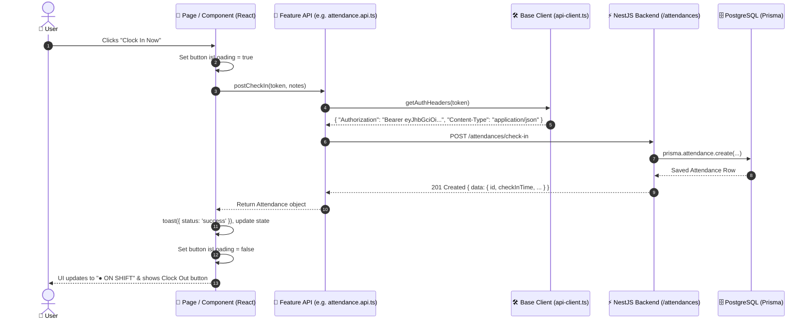

# 🌐 Web API Architecture & Integration Guide

A beginner-friendly guide explaining how the Next.js frontend connects to, authenticates with, and consumes the NestJS backend API.

---

## 📑 Table of Contents
1. [The Big Picture: How Data Flows](#1-the-big-picture-how-data-flows)
2. [Authentication & The Bearer Token](#2-authentication--the-bearer-token)
3. [The Shared API Client Helper](#3-the-shared-api-client-helper)
4. [The 3 Core API Patterns Used in Pages](#4-the-3-core-api-patterns-used-in-pages)
   - [Pattern 1: Page Load (Fetch on Mount)](#pattern-1-page-load-fetch-on-mount)
   - [Pattern 2: User Action / Mutation (Buttons & Forms)](#pattern-2-user-action--mutation-buttons--forms)
   - [Pattern 3: Search & Filters (Debounced Query)](#pattern-3-search--filters-debounced-query)
5. [Complete API Directory by Feature](#5-complete-api-directory-by-feature)
6. [Beginner's Checklist & Best Practices](#6-beginners-checklist--best-practices)

---

## 1. The Big Picture: How Data Flows

When a user opens a page or clicks a button in the web application, this exact chain of events happens:



---

## 2. Authentication & The Bearer Token

### Where does the token come from?
1. The user logs in via [LoginForm.tsx](file:///d:/Dev/T001KMPEX/nestjs-prisma-api/web/features/auth/components/LoginForm.tsx).
2. The backend responds with:
   ```json
   {
     "accessToken": "eyJhbGciOiJIUzI1NiIsInR5cCI6IkpXVCJ9...",
     "user": { "id": "1", "name": "Admin", "role": "admin" }
   }
   ```
3. The [AuthContext.tsx](file:///d:/Dev/T001KMPEX/nestjs-prisma-api/web/features/auth/context/AuthContext.tsx) saves this token in two places:
   * **`localStorage.setItem('auth_token', token)`** (persists across page reloads).
   * **React State `token`** (accessible anywhere via the `useAuth()` hook).

### How to use the token in any component:
```typescript
import { useAuth } from '@/features/auth';

export function MyComponent() {
  const { token, user } = useAuth(); // 👈 Grab token from context

  const handleClick = async () => {
    if (!token) return; // Always verify token exists
    await postCheckIn(token, 'Morning shift');
  };
}
```

---

## 3. The Shared API Client Helper

Every API call shares a single configuration helper in [`web/lib/api-client.ts`](file:///d:/Dev/T001KMPEX/nestjs-prisma-api/web/lib/api-client.ts):

```typescript
// 1. Automatically uses NEXT_PUBLIC_API_URL or defaults to localhost:3000
export const API_BASE_URL = process.env.NEXT_PUBLIC_API_URL || 'http://localhost:3000';

// 2. Automatically attaches the JWT Bearer token if provided
export function getAuthHeaders(token?: string): Record<string, string> {
  const headers: Record<string, string> = {
    'Content-Type': 'application/json',
  };
  if (token) {
    headers['Authorization'] = `Bearer ${token}`;
  }
  return headers;
}
```

---

## 4. The 3 Core API Patterns Used in Pages

### Pattern 1: Page Load (Fetch on Mount)
Used when a page opens and needs data immediately (e.g. Dashboard metrics, table records, schedules).

**Location**: [`web/app/dashboard/page.tsx`](file:///d:/Dev/T001KMPEX/nestjs-prisma-api/web/app/dashboard/page.tsx#L90-L135) or [`web/app/admin/dashboard/page.tsx`](file:///d:/Dev/T001KMPEX/nestjs-prisma-api/web/app/admin/dashboard/page.tsx#L158-L195)

```typescript
function EmployeeDashboardContent() {
  const { token } = useAuth();
  const [loading, setLoading] = useState(true);
  const [records, setRecords] = useState<Attendance[]>([]);

  // 1. Wrap in useCallback to prevent infinite re-render loops
  const loadData = useCallback(async () => {
    if (!token) return;

    try {
      setLoading(true);
      // 2. Parallel fetching with Promise.all for maximum speed
      const [todayRes, attRes] = await Promise.all([
        fetchTodayStatus(token),
        fetchAttendances({ token, page: 1, limit: 10 }),
      ]);

      setRecords(attRes.data);
    } catch (err: any) {
      console.error('Failed to load data:', err.message);
    } finally {
      // 3. Always turn off loading in finally block
      setLoading(false);
    }
  }, [token]);

  // 4. Trigger on initial page render or when token changes
  useEffect(() => {
    loadData();
  }, [loadData]);

  if (loading) return <Spinner />;
  return <AttendanceTable records={records} />;
}
```

---

### Pattern 2: User Action / Mutation (Buttons & Forms)
Used when the user performs an explicit action like clicking "Clock In", submitting a modal, or deleting an employee.

**Example**: Punching Attendance ([`web/app/dashboard/page.tsx#L137-L167`](file:///d:/Dev/T001KMPEX/nestjs-prisma-api/web/app/dashboard/page.tsx#L137-L167))

```typescript
const [punchLoading, setPunchLoading] = useState(false);
const toast = useToast();

const handleCheckIn = async () => {
  if (!token) return;

  setPunchLoading(true); // 1. Set button loading state
  try {
    // 2. Call the API function
    await postCheckIn(token, 'Standard punch in');

    // 3. Show feedback toast
    toast({
      title: 'Punched In Successfully!',
      status: 'success',
      duration: 3000,
      isClosable: true,
    });

    // 4. Re-fetch fresh data from server so UI matches database
    loadData();
  } catch (err: any) {
    // 5. Handle and display server error messages
    toast({
      title: 'Punch In Failed',
      description: err.message,
      status: 'error',
      duration: 4000,
      isClosable: true,
    });
  } finally {
    setPunchLoading(false); // 6. Reset button state
  }
};
```

---

### Pattern 3: Search & Filters (Debounced Query)
Used in tables with search bars or dropdown filters (e.g. Company Roster, Date Range).

**Example**: Employee Search ([`web/app/admin/dashboard/page.tsx#L98-L115`](file:///d:/Dev/T001KMPEX/nestjs-prisma-api/web/app/admin/dashboard/page.tsx#L98-L115))

```typescript
const [employeeSearch, setEmployeeSearch] = useState('');
const [debouncedSearch, setDebouncedSearch] = useState('');

// 1. Debounce 300ms: wait until user stops typing before calling the API
useEffect(() => {
  const timer = setTimeout(() => {
    setDebouncedSearch(employeeSearch);
    setPage(1); // Reset to page 1 on new search
  }, 300);
  return () => clearTimeout(timer); // Cancel timer if user types another letter
}, [employeeSearch]);

// 2. API call includes debouncedSearch in query params
const loadData = useCallback(async () => {
  if (!token) return;
  const res = await fetchAttendances({
    token,
    employeeSearch: debouncedSearch || undefined,
    startDate: startDate || undefined,
    status: statusFilter !== 'all' ? statusFilter : undefined,
  });
  setRecords(res.data);
}, [token, debouncedSearch, startDate, statusFilter]);
```

---

## 5. Complete API Directory by Feature

### 🔐 Auth Feature (`@/features/auth`)
File: [`web/features/auth/api/auth.api.ts`](file:///d:/Dev/T001KMPEX/nestjs-prisma-api/web/features/auth/api/auth.api.ts)

| Function | Method & Endpoint | Description |
| :--- | :--- | :--- |
| `loginUser(credentials)` | `POST /auth/login` | Sends email & password; returns `{ accessToken, user }` |
| `fetchUserProfile(token)` | `GET /auth/profile` | Fetches active user's details for session verification |
| `updateProfile(token, data)` | `PATCH /auth/profile` | Updates active user's name or email |
| `changePassword(token, data)` | `POST /auth/change-password`| Verifies current password and sets new password |

---

### ⏱️ Attendance Feature (`@/features/attendance`)
File: [`web/features/attendance/api/attendance.api.ts`](file:///d:/Dev/T001KMPEX/nestjs-prisma-api/web/features/attendance/api/attendance.api.ts)

| Function | Method & Endpoint | Description |
| :--- | :--- | :--- |
| `fetchAttendances(params)` | `GET /attendances?...` | Paginated records with filters (`status`, `search`, `dates`) |
| `fetchTodayStatus(token, userId?)` | `GET /attendances/today-status`| Returns whether user is currently checked in or out today |
| `postCheckIn(token, notes?)` | `POST /attendances/check-in` | Creates a new check-in attendance record |
| `postCheckOut(token, id, notes?)` | `POST /attendances/:id/check-out`| Clocks out an active attendance record |
| `fetchTimesheet(token, params?)` | `GET /attendances/timesheet` | Summarizes monthly hours, overtime (>8h), and days worked |
| `postLeaveRequest(token, data)` | `POST /attendances/leave` | Registers scheduled PTO or sick leave |
| `downloadAttendanceCsv(token, params)`| `GET /attendances/export` | Triggers a CSV file download in the browser |

---

### 📅 Schedule Feature (`@/features/schedule`)
File: [`web/features/schedule/api/schedule.api.ts`](file:///d:/Dev/T001KMPEX/nestjs-prisma-api/web/features/schedule/api/schedule.api.ts)

| Function | Method & Endpoint | Description |
| :--- | :--- | :--- |
| `fetchMySchedule(token)` | `GET /schedules/my-schedule` | Retrieves logged-in user's weekly assigned shifts |
| `fetchTodaySchedule(token)` | `GET /schedules/today` | Retrieves shift hours assigned for today |
| `postBulkSchedule(token, data)` | `POST /schedules/bulk` | Admin assigns recurring weekly work shifts to an employee |

---

### 👥 Users & Workforce Feature (`@/features/users`)
File: [`web/features/users/api/users.api.ts`](file:///d:/Dev/T001KMPEX/nestjs-prisma-api/web/features/users/api/users.api.ts)

| Function | Method & Endpoint | Description |
| :--- | :--- | :--- |
| `fetchUsers(token)` | `GET /users?limit=50` | Retrieves all employee accounts for management |
| `createUser(token, data)` | `POST /users` | Admin creates a new employee or manager account |
| `updateUser(token, id, data)` | `PATCH /users/:id` | Admin updates role, email, or credentials |
| `deleteUser(token, id)` | `DELETE /users/:id` | Deactivates / deletes an employee account |
| `fetchCurrentlyIn(token)` | `GET /attendances/currently-in` | Live radar of employees actively working on-site |
| `fetchDashboardMetrics(token)` | `GET /attendances/dashboard` | Returns executive KPI counts (Active, Late, PTO, etc.) |

---

## 6. Beginner's Checklist & Best Practices

1. **Always use `token` from `useAuth()`**:
   * Never hardcode tokens. If `token` is missing or null, do not fire the request.
2. **Always handle both Success and Error states**:
   * Use `useToast()` to alert the user of the outcome.
   * Catch `err.message` so the user sees real backend validation errors (e.g., *"Already checked in today"*).
3. **Always reset `loading` in a `finally` block**:
   ```typescript
   try {
     setIsLoading(true);
     await doSomething();
   } catch (err) {
     // handle error
   } finally {
     setIsLoading(false); // 👈 Will ALWAYS execute even if an error occurs
   }
   ```
4. **Re-fetch data after mutation**:
   * When an action changes data in the database (like clocking out or adding an employee), call your `loadData()` function immediately afterwards to synchronize the UI with PostgreSQL.
5. **Keep Pages Thin, Put Logic in Features**:
   * Pages should only coordinate layouts and state.
   * Network requests, types, and domain-specific cards belong in their respective `features/<name>` folder.

