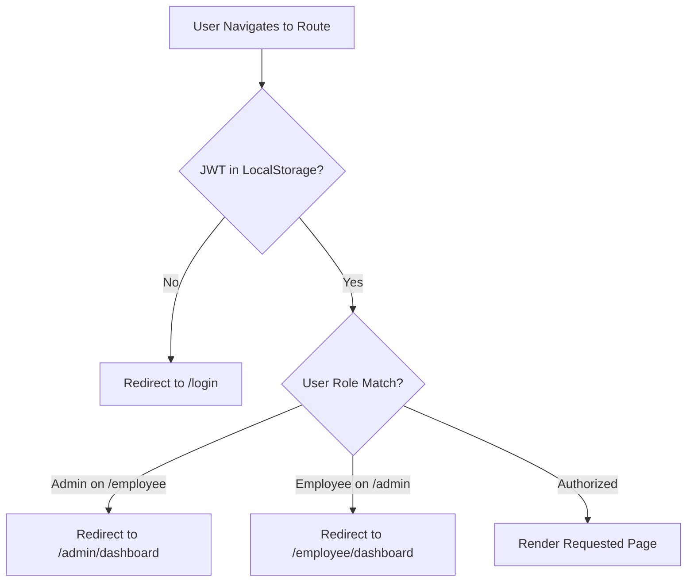

# 🏗️ Web Frontend Architecture & Implementation Guide

A comprehensive, end-to-end explanation of the TKPEX Next.js 14 frontend: how interfaces and data contracts are defined, how components achieve modular reusability, and how state, authentication, and Chakra UI v2 work together.

---

## 📑 Table of Contents

1. [High-Level Architecture & Folder Taxonomy](#1-high-level-architecture--folder-taxonomy)
2. [Interface Contracts & TypeScript Flow](#2-interface-contracts--typescript-flow)
3. [Component Reusability & Composition Patterns](#3-component-reusability--composition-patterns)
4. [State Management & Custom Hook Abstractions](#4-state-management--custom-hook-abstractions)
5. [Role-Based Access Control (RBAC) & Routing](#5-role-based-access-control-rbac--routing)
6. [Chakra UI v2 Design System & Responsive Tokens](#6-chakra-ui-v2-design-system--responsive-tokens)
7. [Step-by-Step Lifecycle Walkthrough](#7-step-by-step-lifecycle-walkthrough)

---

## 1. High-Level Architecture & Folder Taxonomy

The application is built on **Next.js 14 App Router** with a **Feature-Driven Architecture**. Instead of dumping all components into one directory, code is segregated by business domain:

```
web/
├── app/                               # Next.js App Router (Routing Only)
│   ├── layout.tsx                     # Root HTML & Chakra UI Provider
│   ├── page.tsx                       # Root redirector (routes by role)
│   ├── login/page.tsx                 # Sign-in portal
│   ├── register/page.tsx              # Account registration
│   ├── forgot-password/page.tsx       # Password reset token flow
│   ├── admin/
│   │   ├── page.tsx                   # Redirects /admin -> /admin/dashboard
│   │   └── dashboard/
│   │       ├── page.tsx               # Admin orchestrator (190 lines)
│   │       ├── hooks/useAdminDashboard.ts # Admin business logic & state
│   │       └── components/            # Admin-specific presentational views
│   │           ├── AdminHeader.tsx
│   │           ├── ExecutiveKpiGrid.tsx
│   │           ├── AttendanceRosterTab.tsx
│   │           ├── LiveRadarTab.tsx
│   │           └── TeamRosteringTab.tsx
│   └── employee/
│       ├── page.tsx                   # Redirects /employee -> /employee/dashboard
│       └── dashboard/
│           ├── page.tsx               # Employee orchestrator (140 lines)
│           ├── hooks/useEmployeeDashboard.ts # Employee punch logic & state
│           └── components/            # Employee-specific presentational views
│               ├── EmployeeHeader.tsx
│               ├── PunchTerminalCard.tsx
│               ├── EmployeeSummaryCards.tsx
│               ├── ScheduleSection.tsx
│               └── PunchHistorySection.tsx
│
├── features/                          # Domain-Driven Feature Modules
│   ├── auth/                          # Authentication, Tokens, Guard, Profiles
│   │   ├── api/auth.api.ts
│   │   ├── components/                # LoginForm, RegisterForm, ForgotPasswordForm, AuthGuard
│   │   ├── context/AuthContext.tsx
│   │   └── types/index.ts
│   ├── attendance/                    # Punch Clock, Timesheets, Leaves, Roster
│   │   ├── api/attendance.api.ts
│   │   ├── components/                # AttendanceTable, CheckInButton, TimesheetModal
│   │   └── types/index.ts
│   ├── schedule/                      # Shift Roster, Weekly Schedules
│   │   ├── api/schedule.api.ts
│   │   ├── components/                # ScheduleCard, BulkScheduleModal
│   │   └── types/index.ts
│   └── users/                         # Team Management, Presence Radar, User CRUD
│       ├── api/users.api.ts
│       ├── components/                # LivePresenceCard, UserModal, ProfileModal
│       └── types/index.ts
│
├── components/                        # Shared Atomic UI Components
│   ├── Navbar.tsx                     # Universal header with role switcher & profile
│   ├── StatCard.tsx                   # Universal KPI card with badge & tooltip
│   ├── Pagination.tsx                 # Universal paginator with limit select
│   └── DateRangePopover.tsx           # Universal calendar range picker
│
├── lib/
│   └── api-client.ts                  # Fetch wrappers & Authorization bearer headers
└── theme/
    └── index.ts                       # Custom Chakra UI tokens (slate, brand colors)
```

---

## 2. Interface Contracts & TypeScript Flow

TypeScript interfaces ensure strict type contracts from PostgreSQL columns up to the browser DOM:

```mermaid
graph LR
    Prisma[Prisma Schema / DB] --> DTO[NestJS DTOs & Views]
    DTO --> API[fetch() Client in web/features/*/api]
    API --> Hook[Custom Hooks in hooks/*]
    Hook --> Props[React Component Props]
    Props --> JSX[Chakra UI Render]
```

### Core Interface Examples

#### A. User & Session (`features/auth/types/index.ts`)
```typescript
export interface User {
  id: string;
  name: string;
  email: string;
  role: 'admin' | 'user';
  avatarUrl?: string | null;
}

export interface AuthResponse {
  user: User;
  accessToken: string;
}
```

#### B. Attendance Record (`features/attendance/types/index.ts`)
```typescript
export interface Attendance {
  id: string;
  userId: string;
  date: string;
  checkInTime: string;
  checkOutTime: string | null;
  status: 'present' | 'late' | 'on_leave' | 'absent';
  notes?: string | null;
  users?: {
    name: string;
    email: string;
  };
}
```

#### C. Pagination Metadata (`features/attendance/types/index.ts`)
```typescript
export interface PaginationMeta {
  total: number;
  page: number;
  limit: number;
  totalPages: number;
}
```

**Why this matters**:
- Changing a field in the database immediately causes TypeScript compile errors at the component layer, preventing silent production bugs.
- Components declare precise prop interfaces (e.g. `AttendanceRosterTabProps`, `StatCardProps`), making code self-documenting for any beginner reading the codebase.

---

## 3. Component Reusability & Composition Patterns

The codebase avoids duplication by following the **Container vs. Presentational (Dumb Component)** pattern and sharing atomic UI building blocks across roles.

### 1. `AttendanceTable.tsx` (Shared Across Roles)
- **Used by Admin**: To inspect all company employees with manager check-out override capabilities.
- **Used by Employee**: To review their personal punch history with self-service checkout.
- **How it stays reusable**: It accepts `records: Attendance[]` and an optional callback `onCheckOut?: (id: string) => void`. It doesn't care whether the user is an admin or an employee; it simply renders rows cleanly.

### 2. `StatCard.tsx` (Shared Across Roles)
- **Used in Admin KPI Grid**: Renders `Total Employees`, `On-Site Now`, `Late Shifts`, `PTO`.
- **Used in Employee Summary**: Renders `Present Shifts`, `Late Arrivals`, `Approved Leave`, `Total Sessions`.
- **Reusability Contract**:
  ```tsx
  <StatCard
    title="Punched Today"
    value={42}
    badgeText="Live"
    badgeScheme="green"
    tooltip="Employees clocked in right now"
  />
  ```

### 3. `Pagination.tsx` & `DateRangePopover.tsx`
- Fully encapsulated controls that emit standard events (`onPageChange(page)`, `onChange({ startDate, endDate })`).
- Zero coupling to API endpoints; reusable in any data table.

---

## 4. State Management & Custom Hook Abstractions

To keep page files concise (under 200 lines), state and side-effects are decoupled into custom React hooks.

### Architecture Comparison

| Monolithic Approach (Before) | Modular Hook Pattern (After) |
|---|---|
| 968 lines in `page.tsx` | ~140 lines in `page.tsx` |
| 18+ `useState` in one component | State isolated in `useAdminDashboard` |
| Filter typing re-renders entire dashboard | Re-renders scoped strictly to target sub-components |
| Mixed UI layout and API async code | Clean separation: Hook = Logic, Components = UI |

### Custom Hook Mechanics

```
┌────────────────────────────────────────────────────────┐
│                   useAdminDashboard                    │
├────────────────────────────────────────────────────────┤
│ • State: pulse, records, meta, filters, modals         │
│ • Debounce: 300ms timer for employee search            │
│ • API Fetcher: Promise.all() parallel data fetching    │
│ • Actions: handleAdminCheckOut, openScheduleForUser    │
└──────────────────────────┬─────────────────────────────┘
                           │ returns structured object
                           ▼
┌────────────────────────────────────────────────────────┐
│               AdminDashboardContent (Page)             │
├────────────────────────────────────────────────────────┤
│ <AdminHeader onAssignShifts={...} />                   │
│ <ExecutiveKpiGrid pulse={admin.pulse} />               │
│ <Tabs>                                                 │
│   <AttendanceRosterTab {...admin.roster} />            │
│   <LiveRadarTab currentlyInList={admin.live} />        │
│   <TeamRosteringTab {...admin.team} />                 │
│ </Tabs>                                                │
└────────────────────────────────────────────────────────┘
```

---

## 5. Role-Based Access Control (RBAC) & Routing

Security and role gating are handled via the `AuthGuard` component and `AuthContext`.



### Route Symmetries

- **Admin Routes**:
  - `/admin` (Redirects to `/admin/dashboard`)
  - `/admin/dashboard` (Guarded: `allowedRoles={['admin']}`)
- **Employee Routes**:
  - `/employee` (Redirects to `/employee/dashboard`)
  - `/employee/dashboard` (Guarded: `allowedRoles={['user', 'admin']}`)
- **Public Routes**:
  - `/login`
  - `/register`
  - `/forgot-password`

---

## 6. Chakra UI v2 Design System & Responsive Tokens

The application avoids arbitrary inline styles in favor of curated design tokens defined in [`web/theme/index.ts`](../web/theme/index.ts):

### Key Design Tokens
- **Brand Palette**: Custom indigo/blue accents (`brand.500`, `brand.600`, `brand.700`).
- **Surface Grays**: Curated Tailwind-style slate scales (`slate.50` background, `slate.200` borders, `slate.900` text).
- **Glassmorphism & Depth**: Subtle shadows (`shadow="xs"` and `boxShadow="0 4px 20px -2px rgba(0,0,0,0.05)"`).

### Responsive Layout Strategy
All cards and grids utilize Chakra's object-syntax responsive props:
```tsx
// 2 columns on mobile, 3 on tablet, 6 on desktop:
<SimpleGrid columns={{ base: 2, sm: 3, md: 6 }} spacing={3}>
  ...
</SimpleGrid>
```

---

## 7. Step-by-Step Lifecycle Walkthrough

Here is the exact step-by-step lifecycle from cold browser start to live data interaction:

1. **Bootstrapping**:
   - Browser loads `/login`.
   - `AuthGuard` detects no active user in `AuthContext` -> Renders `LoginForm`.

2. **Authentication**:
   - User inputs credentials (`admin@tkpex.com`).
   - `loginUser()` POSTs to `http://localhost:3000/auth/login`.
   - JWT stored in `localStorage('auth_token')`.
   - User state saved -> `router.push('/admin/dashboard')`.

3. **Mounting Dashboard**:
   - `AdminDashboardPage` renders `AuthGuard allowedRoles={['admin']}`.
   - `useAdminDashboard()` executes `loadAdminData()`.
   - Skeletons displayed (`<Skeleton h="28px" />`) while `Promise.all()` runs.

4. **Data Delivery**:
   - Backend queries PostgreSQL via Prisma ORM and returns JSON responses.
   - Skeletons unmount; live data hydrates `StatCard` metrics and `AttendanceTable` rows.

5. **User Mutation (Punch Clock / Action)**:
   - When an action is clicked (e.g. Check-in or Check-out), button enters `isLoading={true}`.
   - `postCheckIn()` executes with `Authorization: Bearer <token>`.
   - Chakra `toast({ status: 'success' })` notifies the user.
   - `loadAllData()` triggers a silent background re-fetch, keeping data synchronized in real-time.
