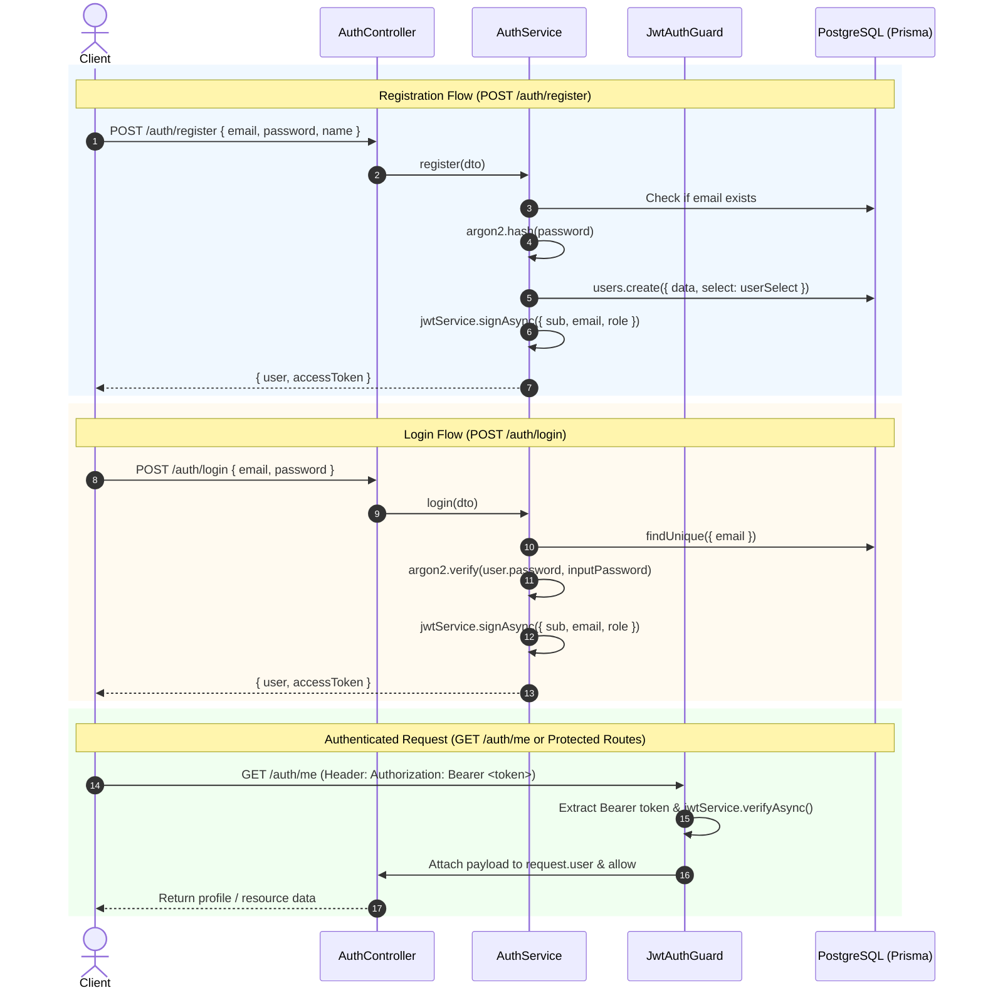

# JWT Authentication & Argon2 Password Hashing Guide

This document details the architecture, implementation, and usage of **Argon2 password hashing** and **JSON Web Token (JWT) authentication** in the TKPEX NestJS & Prisma API.

---

## 1. Architecture & Flow Overview



---

## 2. Argon2 Password Hashing

### Why Argon2?
Argon2 (specifically **Argon2id**) is the winner of the Password Hashing Competition (PHC). Unlike legacy algorithms (MD5, SHA256) and even bcrypt:
- It is **memory-hard**, designed to be resilient against GPU- and ASIC-based brute force cracking.
- It protects against both side-channel attacks and trade-off attacks.

### Installation & Native Build
In this project, `argon2` v0.45.1 is installed. Because pnpm v11 restricts automatic build scripts on Windows, dependencies are approved via:
```bash
pnpm approve-builds --all
```

### Password Hashing (`argon2.hash`)
Used during user registration ([`auth.service.ts`](file:///d:/Dev/T001KMPEX/nestjs-prisma-api/src/auth/services/auth.service.ts)), user creation/update ([`users.service.ts`](file:///d:/Dev/T001KMPEX/nestjs-prisma-api/src/users/services/users.service.ts)), and database seeding ([`seed.mjs`](file:///d:/Dev/T001KMPEX/nestjs-prisma-api/prisma/seed.mjs)):

```typescript
import * as argon2 from 'argon2';

// Generates an Argon2id hash with random salt and standard cost parameters
const hashedPassword = await argon2.hash(plainTextPassword);
```

### Password Verification (`argon2.verify`)
Used during login authentication ([`auth.service.ts`](file:///d:/Dev/T001KMPEX/nestjs-prisma-api/src/auth/services/auth.service.ts)):

```typescript
const isPasswordValid = await argon2.verify(user.password, dto.password);
if (!isPasswordValid) {
  throw new UnauthorizedException('Invalid email or password');
}
```

### Data Layer Protection (`userSelect`)
To ensure that password hashes are **never returned to API clients**, queries and DTO responses utilize projection definitions ([`user.select.ts`](file:///d:/Dev/T001KMPEX/nestjs-prisma-api/src/users/views/user.select.ts)):

```typescript
export const userSelect = {
  id: true,
  name: true,
  email: true,
  role: true,
  createdAt: true,
  updatedAt: true,
  // 'password' is omitted
} satisfies Prisma.usersSelect;
```

---

## 3. JWT Authentication

### Module Registration (`auth.module.ts`)
The authentication module is marked `@Global()`, exposing `JwtModule` and `JwtAuthGuard` across all feature modules without requiring redundant imports.

```typescript
@Global()
@Module({
  imports: [
    JwtModule.register({
      global: true,
      secret: process.env.JWT_SECRET || 'tkpex-super-secret-jwt-key',
      signOptions: { expiresIn: '7d' },
    }),
  ],
  controllers: [AuthController],
  providers: [AuthService, JwtAuthGuard],
  exports: [AuthService, JwtAuthGuard, JwtModule],
})
export class AuthModule {}
```

### Token Structure & Claims
When an access token is issued, it encodes the following JWT claims:

| Field | Description | Example |
| :--- | :--- | :--- |
| `sub` | Subject (User unique UUID) | `"32c8ee58-1578-43d5-8709-d00dbd57ed3c"` |
| `email` | User email address | `"admin@tkpex.com"` |
| `role` | User role for RBAC permissions | `"admin"` or `"user"` |
| `iat` | Issued-at Unix timestamp | `1793178638` |
| `exp` | Expiration Unix timestamp (7 days) | `1793783438` |

### Token Generation
Tokens are generated asynchronously via `JwtService.signAsync()`:

```typescript
private async generateToken(userId: string, email: string, role: string) {
  return this.jwtService.signAsync({
    sub: userId,
    email,
    role,
  });
}
```

---

## 4. Route Protection (`JwtAuthGuard`)

[`JwtAuthGuard`](file:///d:/Dev/T001KMPEX/nestjs-prisma-api/src/auth/guards/jwt-auth.guard.ts) implements NestJS's `CanActivate` interface:
1. Extracts the token from the `Authorization: Bearer <token>` HTTP header.
2. Throws `401 Unauthorized` if the header is missing or malformed.
3. Verifies token integrity and expiration using `jwtService.verifyAsync()`.
4. Attaches the decoded payload to the request object (`req.user`) for access in controllers and parameter decorators.

```typescript
@Injectable()
export class JwtAuthGuard implements CanActivate {
  constructor(private readonly jwtService: JwtService) {}

  async canActivate(context: ExecutionContext): Promise<boolean> {
    const request = context.switchToHttp().getRequest<Request>();
    const token = this.extractTokenFromHeader(request);

    if (!token) {
      throw new UnauthorizedException('Missing authentication token');
    }

    try {
      const payload = await this.jwtService.verifyAsync(token, {
        secret: process.env.JWT_SECRET || 'tkpex-super-secret-jwt-key',
      });
      (request as any).user = payload;
    } catch {
      throw new UnauthorizedException('Invalid or expired authentication token');
    }

    return true;
  }

  private extractTokenFromHeader(request: Request): string | undefined {
    const [type, token] = request.headers.authorization?.split(' ') ?? [];
    return type === 'Bearer' ? token : undefined;
  }
}
```

---

## 5. Protecting Any Controller or Endpoint

Because `AuthModule` is global, you can protect any endpoint or entire controller simply by importing and applying `@UseGuards(JwtAuthGuard)`:

### Example: Protecting an Entire Controller
```typescript
import { Controller, Get, UseGuards } from '@nestjs/common';
import { ApiBearerAuth, ApiTags } from '@nestjs/swagger';
import { JwtAuthGuard } from '../auth/guards/jwt-auth.guard.js';

@ApiTags('Schedules')
@ApiBearerAuth()
@UseGuards(JwtAuthGuard)
@Controller('schedules')
export class SchedulesController {
  // All endpoints in this controller now require a valid Bearer token
}
```

### Example: Accessing Current User Inside a Handler
```typescript
@Get('me')
@UseGuards(JwtAuthGuard)
@ApiBearerAuth()
getProfile(@Request() req: any) {
  // req.user contains { sub, email, role, iat, exp }
  return req.user;
}
```

---

## 6. API Usage & Curl Examples

### 1. Register a New Account
```bash
curl -X POST http://localhost:3000/auth/register \
  -H "Content-Type: application/json" \
  -d '{
    "name": "Jane Developer",
    "email": "jane@tkpex.com",
    "password": "StrongPassword!234",
    "role": "user"
  }'
```
**Response (201 Created):**
```json
{
  "success": true,
  "statusCode": 201,
  "data": {
    "user": {
      "id": "e6740fcb-...",
      "name": "Jane Developer",
      "email": "jane@tkpex.com",
      "role": "user",
      "createdAt": "2026-10-28T09:10:56.865Z"
    },
    "accessToken": "eyJhbGciOiJIUzI1NiIsInR5cCI6..."
  }
}
```

### 2. Login
```bash
curl -X POST http://localhost:3000/auth/login \
  -H "Content-Type: application/json" \
  -d '{
    "email": "admin@tkpex.com",
    "password": "password!!!"
  }'
```
**Response (200 OK):**
```json
{
  "success": true,
  "statusCode": 201,
  "data": {
    "user": {
      "id": "32c8ee58-1578-43d5-8709-d00dbd57ed3c",
      "name": "System Admin",
      "email": "admin@tkpex.com",
      "role": "admin"
    },
    "accessToken": "eyJhbGciOiJIUzI1NiIsInR5cCI6..."
  }
}
```

### 3. Access Protected Route (`GET /auth/me`)
```bash
curl http://localhost:3000/auth/me \
  -H "Authorization: Bearer <accessToken>"
```
**Response (200 OK):**
```json
{
  "success": true,
  "statusCode": 200,
  "data": {
    "sub": "32c8ee58-1578-43d5-8709-d00dbd57ed3c",
    "email": "admin@tkpex.com",
    "role": "admin",
    "iat": 1793178642,
    "exp": 1793783442
  }
}
```

---

## 7. Swagger UI Testing

1. Open your browser to `http://localhost:3000/api/docs`.
2. Click the **Authorize** button (top right with the lock icon).
3. Paste the `accessToken` obtained from `/auth/login` or `/auth/register`.
4. Click **Authorize** $\rightarrow$ **Close**.
5. All protected endpoints decorated with `@ApiBearerAuth()` will now automatically include the token in test requests.

